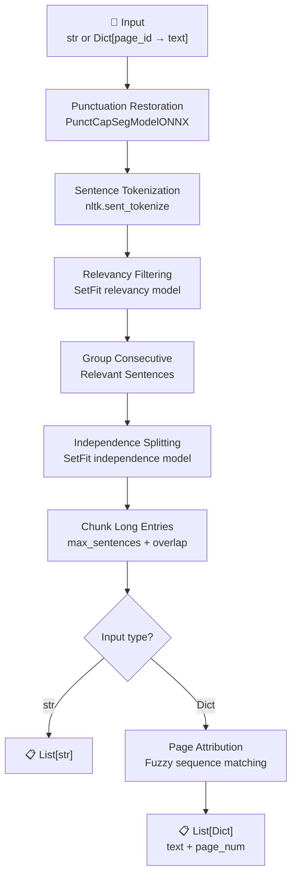
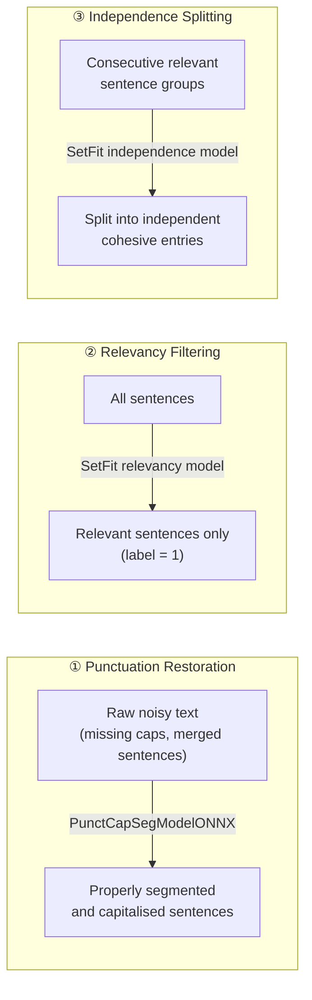
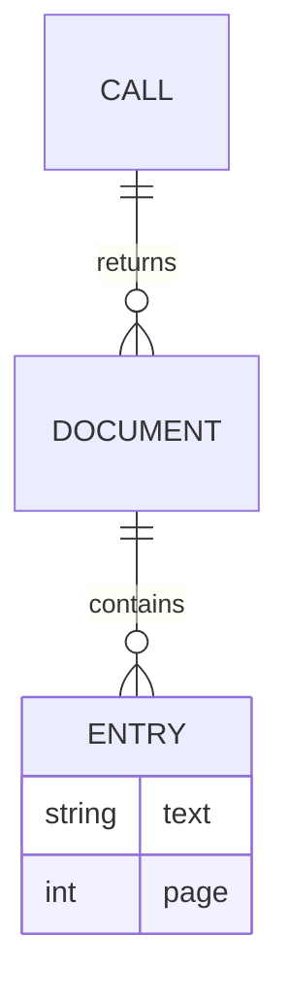

# Entry Extraction

Extracts semantically coherent entries from raw document text — filtering noise, restoring punctuation, and grouping related sentences into discrete, meaningful units.

## Pipeline



## Installation

```bash
pip install git+https://github.com/MediaMonitoringAndAnalysis/EntryExtraction.git
```

## Usage

### String input

```python
from entry_extraction import SemanticEntriesExtractor

extractor = SemanticEntriesExtractor()

entries = extractor(["Your raw document text goes here. Multiple sentences. Some relevant, some not."])
# → [["Relevant sentence one.", "Relevant sentence two grouped with it."]]
```

### Page-dict input

Pass a `dict` mapping page identifiers to text to get page numbers back with each entry.

```python
pages = {
    "page_0": "Header text. Report metadata. Location names.",
    "page_1": "Violent storms killed at least eight people. Thousands of buildings damaged.",
    "page_2": "Six victims died in Mandalay after flash flooding. Shan and Chin states also struck.",
}

entries = extractor([pages])
```

**Output:**
```python
[
  [
    {"text": "Violent storms killed at least eight people. Thousands of buildings damaged.", "page": 1},
    {"text": "Six victims died in Mandalay after flash flooding. Shan and Chin states also struck.", "page": 2},
  ]
]
```

### Real example output

Input: a 4-page Myanmar hailstorm situation report (mixed metadata, narrative, stats).

```
Extracting entries from documents: 100%|██████████| 1/1 [00:02<00:00, 2.64s/it]
```

```python
[
  [
    {"text": "YANGON (AFP) - Violent storms which saw hailstones the size of golf balls rain down across Myanmar have killed at least eight people in recent days, toppled pagodas and damaged thousands of buildings, officials said on Sunday (April 24)..", "page": 1},
    {"text": "The freak storms struck across five states on Friday and Saturday after weeks of heatwave, temperatures regularly topping 40deg C..", "page": 1},
    {"text": "Six of the victims died in Yay Tha Yauk village in the central region of Mandalay after flash flooding.. Other regions that were struck included Sagaing and Magway, as well as the states of Shan and Chin..", "page": 1},
    {"text": "Pictures and TV footage showed huge hailstones crashing onto flooded streets and clattering off metal roofs as residents rushed for shelter..", "page": 1},
    {"text": "\"I felt afraid of the strong wind, the rain and the hailstones when I looked out the window,\" Yin Myo, a resident of Mandalay, told AFP.. \"Some hailstones were as large as golf balls, most about the size of ice cubes you put in drinks,\" she added, saying her aunt's house had been damaged..", "page": 2},
    {"text": "The state-run Global New Light of Myanmar said more than 1,700 pagodas were damaged by gale-force winds in the southern state of Shan on Friday night..", "page": 2},
    {"text": "Pictures on social media showed some of the pagoda spires, which were hundreds of years old, lying shattered on the ground..", "page": 2},
    {"text": "Like much of the Greater Mekong region, Myanmar has been hit by drought in recent weeks amid a particularly fierce dry season..", "page": 2},
  ]
]
```

> Metadata headers, URLs, navigation links, and boilerplate from pages 0 and 3 were fully filtered out.

## What each step does



| Step | Model / Method | Purpose |
|------|---------------|---------|
| Punctuation restoration | `1-800-BAD-CODE/xlm-roberta_punctuation_fullstop_truecase` | Fix sentence boundaries in OCR/PDF text |
| Relevancy filtering | `Sfekih/sentence_relevancy_model` | Remove boilerplate, metadata, navigation text |
| Independence splitting | `Sfekih/sentence_independancy_model` | Split topic-shift boundaries within relevant groups |
| Long entry chunking | Sliding window | Cap entries at `max_sentences` with `overlap` context |
| Page attribution | Fuzzy sequence matching (`SequenceMatcher`) | Map each entry back to its source page |

## Configuration

```python
SemanticEntriesExtractor(
    relevancy_model_name   = "Sfekih/sentence_relevancy_model",
    independance_model_name= "Sfekih/sentence_independancy_model",
    punct_model_name       = "1-800-BAD-CODE/xlm-roberta_punctuation_fullstop_truecase",
    max_sentences          = 5,    # max sentences per entry before chunking
    overlap                = 2,    # sentence overlap when chunking long groups
    delete_question_entries= False # drop any entry containing "?"
)
```

## Output schema



- **String input** → each entry is a plain `str`
- **Dict input** → each entry is `{"text": str, "page": int}`
- Page number is resolved via longest common subsequence matching against the original page texts; falls back to the previous entry's page if no match is found

## Next Steps

- Add training data and code
- Train multilingual models
